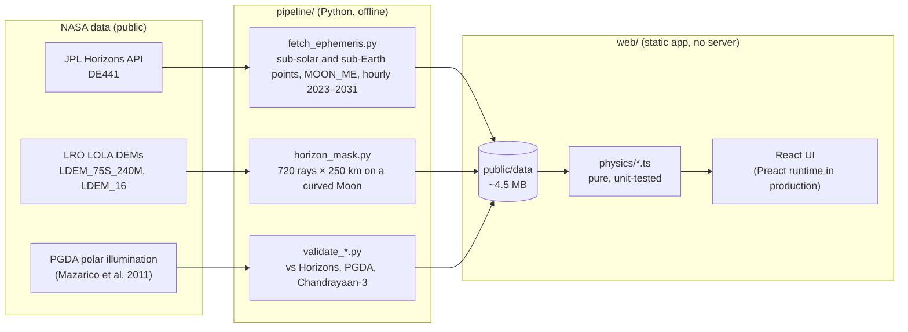

# LunaWindow

**Explore. Compare. Plan. Experience.** Find the right place and time to land on the Moon.
This project is for the NASA Space Apps Challenge 2026: [Lunar Landing Site Navigator](https://www.spaceappschallenge.org/2026/challenges/lunar-landing-site-navigator/).


**Where and when should a lunar mission operate to get sunlight and a direct line to Earth?** At the lunar south pole the Sun skims the horizon, so a single ridge decides whether a lander has power, and Earth's monthly wobble decides whether it can call home.

LunaWindow connects three things in one decision-support tool:
- your **mission requirements**,
- **NASA astronomical and terrain data** (JPL Horizons, LRO LOLA),
- an **observer's view from the lunar surface**.

It answers three questions:
- **Where?** Which site.
- **When?** Which dates.
- **Why?** Which Sun and Earth geometry explains the result.

It is a preliminary tool and does not certify landing safety.

**Live demo:** https://muxsinjon.github.io/lunawindow/ · **Source:** https://github.com/Muxsinjon/lunawindow

## Workspaces (one shared mission state, in the URL)
- **Welcome:** choose "Explore landing sites" or "Plan a lunar mission", or **Try the guided demo**, a 10-step walkthrough on real data.
- **Explore & Compare:**
  - Site A vs Site B from 17 cited sites (or your own coordinates, or a click on the south-pole map).
  - Mission start, a 1/3/7/14/30-day duration and a shared time bar (previous/next hour, play, speed).
  - Status per site: Sun and Earth azimuth and elevation, visible or not, next rise or set as an hour window.
  - **Sun elevation and Earth elevation vs time** charts for both sites, with a 0° line, tooltips and a synced cursor.
  - A **visibility timeline** (Sun, Earth, both, neither) with **Highlight differences**.
  - A **comparison table** (11 metrics, including blackouts, interruptions and longest continuous intervals) with generated **trade-off** sentences.
- **Mission Window Finder:**
  - Your requirements: duration, earliest and latest start, minimum sunlight %, minimum Earth %, optional minimum joint %, maximum darkness, maximum blackout. The defaults are illustrative, not NASA standards.
  - It searches **all sites** in about half a second and sorts every candidate into **Meets / Partially meets / Does not meet / Insufficient data**, with a transparent ranking (hard requirements first).
  - A site × day overview grid and a sortable, filterable results list.
  - **Why this window?** explains which requirements pass or fail using the actual numbers (e.g. *"The modeled uninterrupted loss of Earth visibility is 50 h, while the mission allows only 48 h"*), plus the best period, the critical interruptions and the alternatives. From there you can jump to Explore & Compare, Surface View or the critical moment.
- **Surface View:**
  - The 360° view from the site: a black sky, the real LOLA terrain silhouette, and the Sun and Earth at their true angular sizes (Earth's phase is computed).
  - Drag to look around, Look at the Sun / Look at Earth, field of view, an optional labelled vertical exaggeration, a compass strip and a 360° overview.
  - A plain-language reason for the current visibility state.
- **Mission summary:** a printable HTML/PDF report or a JSON download (sites, coordinates, dates, requirements, metrics, pass/fail, interruptions, sources, limitations).
- **About & methodology:** both visibility models, the sampling method, datasets, the supported sites and dates, validation and limitations.

Header switches:
- **Terrain-aware ↔ Geometric 0°** visibility model
- **Planner ↔ Explain** (plain-language mode)
- **UTC ↔ local time**
- dark or light theme
- **Copy link**: any view can be shared exactly.

## Visibility models
| Model | Visible when… | Label shown next to results |
|---|---|---|
| Terrain-aware (default) | the upper edge of the disc is above the LRO LOLA terrain horizon | "Terrain-aware visibility: upper limb above the LRO LOLA horizon (240 m terrain)" |
| Geometric 0° | the disc centre is above the smooth geometric horizon | "Geometric visibility — local terrain obstruction not included." |

Both models use **hourly samples on half-open intervals**: a sample covers the following hour, and durations are whole hours. Rise and set times are reported as one-hour windows. Dates outside 2023–2031 are never extrapolated; they're adjusted with an explanation, or marked "insufficient data".

## How it works



1. **Sun and Earth.** For every hour from 2023 to 2031, Horizons gives the sub-solar and sub-Earth points on the Moon in the body-fixed frame. The browser turns them into azimuth and elevation for *any* lunar coordinate, including libration. A 6-hour file is shipped and interpolated back to hourly in the browser, which adds no measurable error.
2. **Real horizon.** For each site we cast 720 rays out to 250 km over LOLA terrain, using exact spherical geometry: the curvature drop d²/2R with R = 1737.4 km, no refraction. Custom spots are computed in the browser from a 960 m grid.
3. **Mission meaning.** Sunrise and sunset happen when the **upper limb** crosses the terrain. Partial visibility is the disc area above the horizon. From these windows we derive countdowns, the operations window, the longest dark period, power and the landing calendar.

## Validation (details: [docs/VALIDATION.md](docs/VALIDATION.md))
| Check | Result |
|---|---|
| Sun and Earth elevation vs JPL Horizons topocentric, 3 sites × 3 times (browser code path, unit-tested) | worst **0.0034°** (the Sun's disc is 0.533° wide) |
| Sunlit and Earth-visible % vs LOLA team maps, 7 polar sites | within **1–7 percentage points** |
| Chandrayaan-3 (2023): predicted local sunset | **2023-09-04 09:00 UTC**. ISRO put Vikram to sleep early that day, ahead of the lunar night |
| Shackleton crater floor over a full year | **0 %** sunlit (permanent shadow), as expected |

## Run locally
```bash
cd web
npm install
npm run dev        # http://localhost:5173
npm test           # 61 unit tests (physics, visibility models, finder, state, Horizons cross-check)
npm run lint && npm run build
```

Playwright smoke tests (Python):
```bash
pip install playwright && python -m playwright install chromium
cd web && npx vite preview --port 4173 &
python ../tests/e2e/smoke_test.py http://localhost:4173/
```

Rebuild the data (about 200 MB of NASA downloads into `pipeline/raw/`, which is gitignored):
```bash
cd pipeline
python -m venv .venv && .venv/Scripts/pip install numpy requests rasterio pyproj playwright
.venv/Scripts/python fetch_ephemeris.py       # JPL Horizons -> ephem.bin
.venv/Scripts/python horizon_mask.py          # LOLA -> sites.json, browser DEMs
.venv/Scripts/python export_overlays.py       # PGDA -> map overlays
.venv/Scripts/python validate_ephemeris.py    # vs Horizons topocentric
.venv/Scripts/python validate_illumination.py # vs PGDA maps
.venv/Scripts/python validate_missions.py     # Chandrayaan-3
.venv/Scripts/python validation_table.py      # docs/VALIDATION.md + test fixture
.venv/Scripts/python make_brand_assets.py     # OG image and favicons
```
The DEMs come from `http://imbrium.mit.edu/DATA/LOLA_GDR/` (`POLAR/IMG/LDEM_75S_240M.*`, `CYLINDRICAL/IMG/LDEM_16.*`). The illumination maps come from `https://pgda.gsfc.nasa.gov/data/MoonIllumination/` (`AVGVISIB_75S_120M_201608.TIF`, `..._EARTH.TIF`).

## Deploy
Push to `main` and `.github/workflows/pages.yml` builds, tests and publishes to GitHub Pages. In the repo settings, set Pages to use GitHub Actions. `ci.yml` runs lint, format check, unit tests, build and the Playwright smoke tests on every push.

## Tech stack
TypeScript (strict), React 19 API (Preact runtime in production builds), hand-written SVG charts, Vite, Vitest, ESLint, Prettier, hand-written SVG and canvas charts, and Python (NumPy, rasterio, Playwright) for the data pipeline. Design system: [docs/DESIGN_SYSTEM.md](docs/DESIGN_SYSTEM.md).

## References
**NASA data**
- JPL Horizons System, DE441. https://ssd.jpl.nasa.gov/horizons/ (API retrieved 2026-11-14)
- LRO LOLA Gridded Data Records LDEM_75S_240M and LDEM_16 (Smith et al., LOLA team), NASA PDS. http://imbrium.mit.edu/DATA/LOLA_GDR/
- Mazarico, E., Neumann, G. A., Smith, D. E., Zuber, M. T., Torrence, M. H. (2011). Illumination conditions of the lunar polar regions using LOLA topography. *Icarus* 211, 1066–1081. Data: https://pgda.gsfc.nasa.gov/products/69
- LROC QuickMap (context and site checks): https://quickmap.lroc.asu.edu/
- CSA Moon Exploration portal (Space Agency Partner resource): https://www.asc-csa.gc.ca/eng/astronomy/moon-exploration/

**Landing-site coordinates** (each site also shows its source in the app)
- Artemis III 2023 workshop abstract #2036 (Connecting Ridge, Peak near Shackleton): https://www.hou.usra.edu/meetings/Artemis_III_2023/pdf/2036.pdf
- Evaluating potential landing sites for the Artemis III mission, *Acta Astronautica* 226 (2025) 469 (Nobile Rim 2): https://arxiv.org/abs/2406.19863
- IM-1 (LROC), IM-2 (Wikipedia "IM-2"), Blue Ghost Mission 1 (LROC/Firefly), Apollo 11–17 (LROC/NASA), Chandrayaan-3 (ISRO), SLIM (JAXA), Chang'e 4 (LROC). Sites marked "Needs verification" are flagged in the app.

**Mission record (validation)**
- The National, 5 Sep 2023, "India's Chandrayaan-3 mission lander and rover in sleep mode for lunar night".
- India TV News, 21 Sep 2023, on the 22 Sep wake-up attempt.

**Software** (all open source): React, Preact, Vite, Vitest, TypeScript, ESLint, Prettier, Playwright, NumPy, rasterio, pyproj, requests. **Fonts:** Barlow and Barlow Semi Condensed (Jeremy Tribby, SIL OFL), self-hosted from Google Fonts; source hashes and licenses are in `web/public/fonts/`.
**Images:** all original. The favicon and OG image are hand-coded SVG drawn from our own LOLA horizon data. No NASA logos or insignia are used, and no AI-generated images.

## Use of AI
We used an AI coding assistant. Every task is logged in [docs/AI_USAGE.md](docs/AI_USAGE.md), as the Space Apps rules require.

## Team
_Add team member names and roles here._

## License
MIT for the code ([LICENSE](LICENSE)). The NASA data is public domain; please cite the sources above.

## 3D lunar terrain explorer

The **3D Terrain** workspace provides a real Three.js terrain mesh from NASA PGDA's Connecting Ridge **Site01 5 m LOLA DEM**, with rotation, zoom, pan, surface-point selection and lunar coordinate/elevation/RMS readouts linked to Site A/B. The browser uses a documented 20 m mesh over 8 × 8 km. Optional real LROC WAC imagery is projected onto that terrain as coarse context; independent landmark co-registration is unverified and the texture is off by default.

Existing mission planning, comparisons, astronomical calculations and 360° Surface View are preserved. See [project status](docs/PROJECT_STATUS.md) and [verified sources, processing and tests](docs/TERRAIN_3D.md) for source uncertainty, decimation error, image limitations and local review commands.

Final Milestone 1 results: [acceptance report](docs/MILESTONE1_ACCEPTANCE.md).

## Scientific terrain screening (Milestone 2)

Within **3D Terrain**, select a location and use **Scientific terrain analysis** to view slope, detrended RMS roughness and threshold-based hazard overlays. Configure slope/RMS requirements and a circular footprint to inspect sample-based coverage and min/mean/max statistics. Native 5 m data drives science; the 20 m mesh is display geometry only. This screens selected terrain criteria, not all landing hazards. See [acceptance and limitations](docs/MILESTONE2_ACCEPTANCE.md) and [data inventory](docs/DATA_SOURCES.md).
